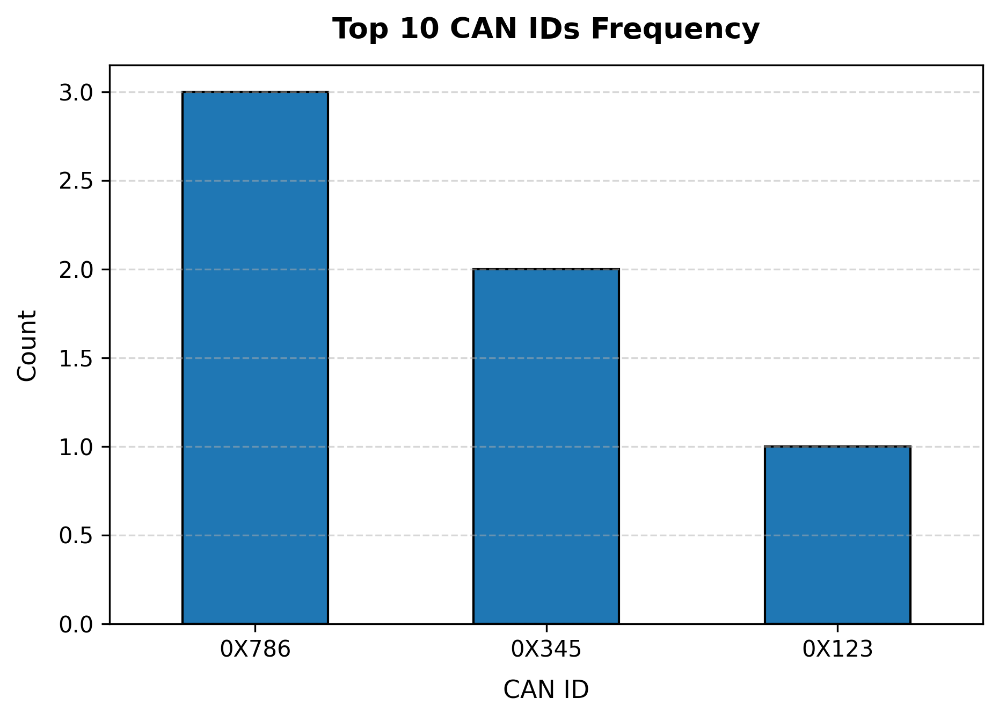
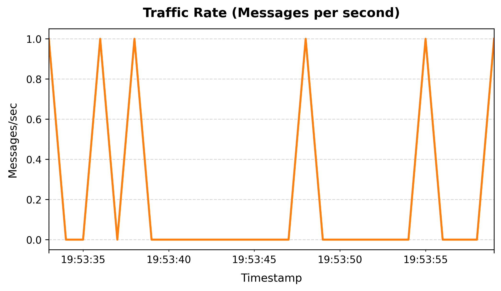
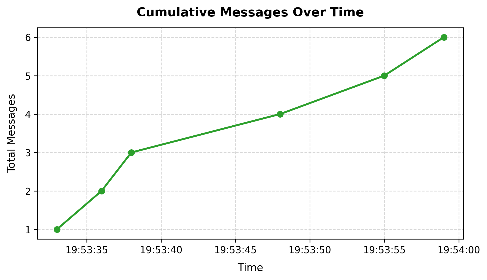

# CANWatch: Real-Time CAN Bus Data Logger & Analytics Platform

[](https://www.python.org/)
[](https://www.kernel.org/doc/html/latest/networking/can.html)
[](LICENSE)

**CANWatch** is a Python-based automotive CAN (Controller Area Network) bus monitoring, data logging, and telemetry analytics platform. Developed as part of the **IEEE Computer Society Internship Program**, CANWatch provides end-to-end tooling to sniff CAN frames via SocketCAN, log structured frames to CSV, isolate transmission anomalies, and generate graphical traffic visualizations.

---

## 🌟 Key Features

* **Real-Time CAN Sniffing & Logging:** Interfaces directly with Linux SocketCAN (`python-can`) to capture frames with sub-millisecond precision.
* **Flexible Ingestion & Filtering:** Filter live traffic by arbitration ID (`--filter-id`), payload substrings (`--filter-payload`), capture duration, or packet count.
* **Payload Anomaly Detection:** Automatically flags and isolates non-standard payloads (such as truncated or non-8-byte frames) and sudden frequency variations.
* **Telemetry Data Visualizations:** Generates publication-ready figures for CAN ID distribution, instantaneous traffic rate (messages/sec), and cumulative frame accumulation over time.
* **Standard CSV Export:** Serializes frame sequences (`Count`, `Timestamp`, `CAN_ID`, `Data`) for downstream data science and automotive diagnostic pipelines.

---

## 📁 Repository Structure

```text
CANWatch/
├── data/
│   ├── can_log.csv              # Captured CAN bus frames dataset
│   ├── can_id_frequency.png     # Frequency distribution of CAN IDs
│   ├── traffic_rate.png         # Messages per second over time
│   └── cumulative_messages.png  # Cumulative frame accumulation curve
├── src/
│   ├── canwatch.py              # Real-time SocketCAN sniffer & logger
│   ├── analyze_can.py           # Anomaly detector & analytics dashboard
│   └── scapy_sniffer.py         # Lightweight Scapy-based frame sniffer
├── requirements.txt             # Python dependencies
└── README.md                    # Project documentation
```

---

## 📊 Visualizations

### 1. Top CAN IDs Frequency
Identifies the most active ECUs (Electronic Control Units) transmitting on the bus.


### 2. Traffic Rate Over Time
Tracks bus load and frame throughput (messages per second) to pinpoint burst transmissions or bus flooding.


### 3. Cumulative Messages Over Time
Monitors overall frame accumulation across continuous logging sessions.


---

## 🚀 Getting Started

### Prerequisites

* Linux / Ubuntu (Desktop or Server) with CAN / `vcan` kernel modules.
* Python 3.8 or higher.

### Installation

1. **Clone the repository:**
   ```bash
   git clone https://github.com/VaishnaviS249/CANWatch.git
   cd CANWatch
   ```

2. **Install required dependencies:**
   ```bash
   pip install -r requirements.txt
   ```
   *(Or individually: `pip install pandas matplotlib python-can scapy`)*

3. **Set up a Virtual CAN Interface (`vcan0`):**
   ```bash
   sudo modprobe vcan
   sudo ip link add dev vcan0 type vcan
   sudo ip link set up vcan0
   ```

---

## 💻 Usage

### 1. Real-Time Packet Logging (`canwatch.py`)

Capture live CAN frames on `vcan0` (or a physical interface like `can0`) and serialize them to CSV:

```bash
cd src
python3 canwatch.py --iface vcan0
```

#### Common Options:
* **Log a fixed number of frames:**
  ```bash
  python3 canwatch.py --count 100
  ```
* **Log for a specific duration (seconds):**
  ```bash
  python3 canwatch.py --duration 30
  ```
* **Filter by specific Arbitration IDs with color highlighting:**
  ```bash
  python3 canwatch.py --filter-id 0x786,0x123 --color
  ```
* **Filter by payload substring:**
  ```bash
  python3 canwatch.py --filter-payload deadbeef
  ```

---

### 2. Telemetry Analytics & Anomaly Detection (`analyze_can.py`)

Analyze recorded frame logs (`../data/can_log.csv`), detect anomalies, and generate charts:

```bash
cd src
python3 analyze_can.py
```

#### Console Output Sample:
```text
First few rows:
   Count            Timestamp CAN_ID              Data  Data_Length
0      1  2025-09-14 19:53:33  0X786  1122334455667788            8
1      2  2025-09-14 19:53:36  0X786  1122334455667788            8
2      3  2025-09-14 19:53:38  0X786          a1b2c3d4            4
3      4  2025-09-14 19:53:48  0X123  0102030405060708            8
4      5  2025-09-14 19:53:55  0X345  1122334455667788            8

[Anomalies: Non-8 byte payloads]
   Count            Timestamp CAN_ID      Data  Data_Length
2      3  2025-09-14 19:53:38  0X786  a1b2c3d4            4
5      6  2025-09-14 19:53:59  0X345  a1b2c3d4            4

Most common payloads:
Data
1122334455667788    3
a1b2c3d4            2
0102030405060708    1
Name: count, dtype: int64
```

---

## 🛠️ Built With

* [Python 3](https://www.python.org/) - Core programming language
* [python-can](https://python-can.readthedocs.io/) - CAN bus protocol interface & SocketCAN driver
* [pandas](https://pandas.pydata.org/) - Telemetry time-series parsing and data wrangling
* [matplotlib](https://matplotlib.org/) - Data visualization and plotting
* [Scapy](https://scapy.net/) - Packet manipulation and secondary packet sniffing

---

## 👥 Authors & Acknowledgments

* **Vaishnavi S** - *Team Lead & Core Developer*
* Developed under the **IEEE Computer Society Internship Program**.
